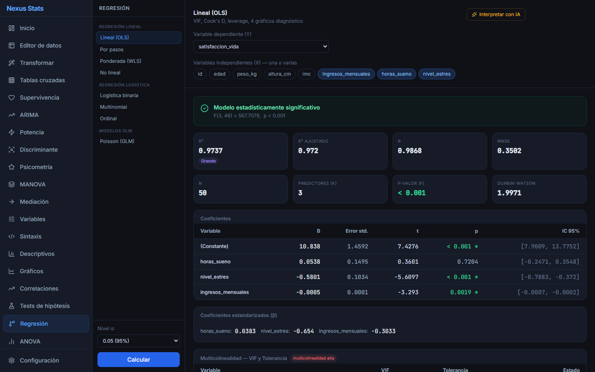
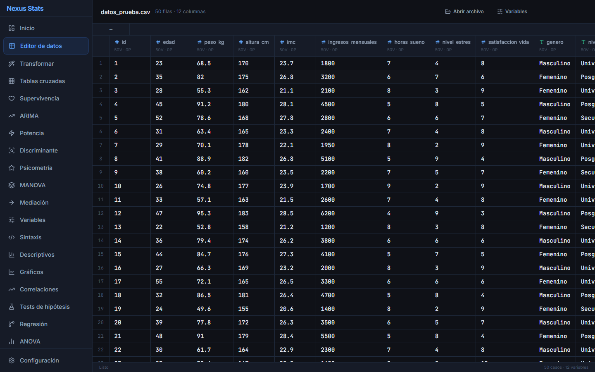

<p align="center"></p>

# Nexus Stats — Análisis estadístico para investigadores

[](https://github.com/FernandoJose25/nexus-stats/actions/workflows/ci.yml)


App de escritorio gratuita para hacer análisis estadístico **en español**, como alternativa moderna a IBM SPSS. Está pensada para tesistas e investigadores hispanohablantes. **[Descargar instalador para Windows](https://github.com/FernandoJose25/nexus-stats/releases/latest)**.

> **English summary:** Free desktop statistics package (SPSS alternative) for Spanish-speaking researchers. Electron + React UI talking to a local Python FastAPI engine (pandas, SciPy, statsmodels, pingouin, scikit-learn) with 30+ analysis modules: descriptives, hypothesis tests, linear/logistic/Poisson regression, ANOVA/MANOVA/GLM, factor analysis, clustering, decision trees, ARIMA, survival, reliability, mediation and power analysis. APA 7 Word and PDF exports, AI-assisted interpretation (Groq), packaged with PyInstaller + electron-builder and auto-updating from GitHub Releases. 127 pytest tests cover every router.



## Mi rol

Proyecto personal hecho por mí de punta a punta: arquitectura Electron + motor Python, los más de 30 módulos estadísticos, la interfaz, los tests, el empaquetado y la distribución con auto-actualización.

## Qué hace

- **Editor de datos** tipo hoja de cálculo con vista de variables. Abre CSV, Excel, SPSS (`.sav`), SAS y Stata.
- **Transformar** variables y **sintaxis** para repetir análisis.
- **Análisis disponibles:**
  - descriptivos y frecuencias;
  - tablas cruzadas y chi-cuadrado;
  - pruebas de hipótesis paramétricas y no paramétricas;
  - correlaciones;
  - regresión lineal (OLS con VIF, distancia de Cook y gráficos de diagnóstico), por pasos, ponderada, no lineal, logística, multinomial, ordinal y Poisson;
  - ANOVA, ANCOVA, MANOVA y GLM;
  - análisis factorial, fiabilidad (alfa de Cronbach, kappa) y psicometría;
  - clustering (k-means y jerárquico), análisis discriminante, árboles de decisión y escalamiento multidimensional;
  - series temporales y ARIMA;
  - supervivencia;
  - mediación;
  - análisis de potencia y tamaño de muestra.
- **Gráficos interactivos** (Plotly): barras, histograma, dispersión, boxplot, violín, Q-Q, P-P y matriz de dispersión.
- **Interpretación con IA** de los resultados en lenguaje simple (Groq).
- **Exportar** informes a Word con formato **APA 7** y a PDF.
- **Instalador para Windows** con auto-actualización desde GitHub Releases.



## Stack

| Capa | Tecnologías |
|---|---|
| Escritorio | Electron 31 (proceso principal + preload con IPC seguro), electron-builder (NSIS), electron-updater |
| UI | React 18, React Router, Zustand, Tailwind CSS, Plotly.js, i18n español/inglés |
| Motor estadístico | Python 3.11, FastAPI (servidor local), pandas, NumPy, SciPy, statsmodels, pingouin, scikit-learn, DuckDB, ReportLab |
| Empaquetado del motor | PyInstaller |
| Calidad | pytest (127 tests sobre todos los routers), GitHub Actions |

## Arquitectura

```
electron/          Ventana, ciclo de vida, diálogos de archivo, auto-actualización e IPC
src/               UI en React: una página por módulo, stores de Zustand, cliente HTTP del motor
python/main.py     Servidor FastAPI local que Electron arranca como proceso hijo
python/routers/    Un router por módulo estadístico (34 routers, ~10 000 líneas)
python/services/   data_manager (dataset en memoria) y stats_engine
python/tests/      Tests de todos los routers con FastAPI TestClient
```

**¿Por qué un servidor FastAPI local?** Separa la UI de la implementación estadística: el renderer de Electron no puede importar Python directamente, y un servidor HTTP local es la forma más simple, testeable y fácil de depurar de unirlos. Además, cada router se prueba aislado con `TestClient`.

## Correr el proyecto

Requisitos: Node 20+ y Python 3.11.

```bash
npm install
pip install -r python/requirements.txt -r python/requirements-dev.txt

npm run dev                      # motor Python + Vite + Electron
cd python && python -m pytest    # tests del motor
npm run build                    # build de la UI
```

Para generar el instalador: `cd python && pyinstaller nexus_engine.spec`, luego `npm run build:electron`.
Hay datos de ejemplo en `examples/datos_prueba.csv`.
